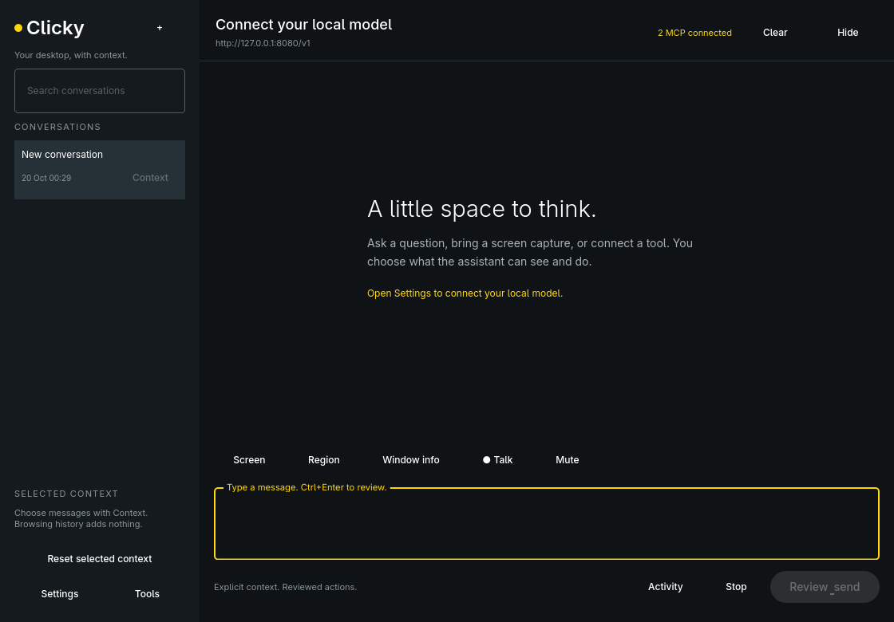
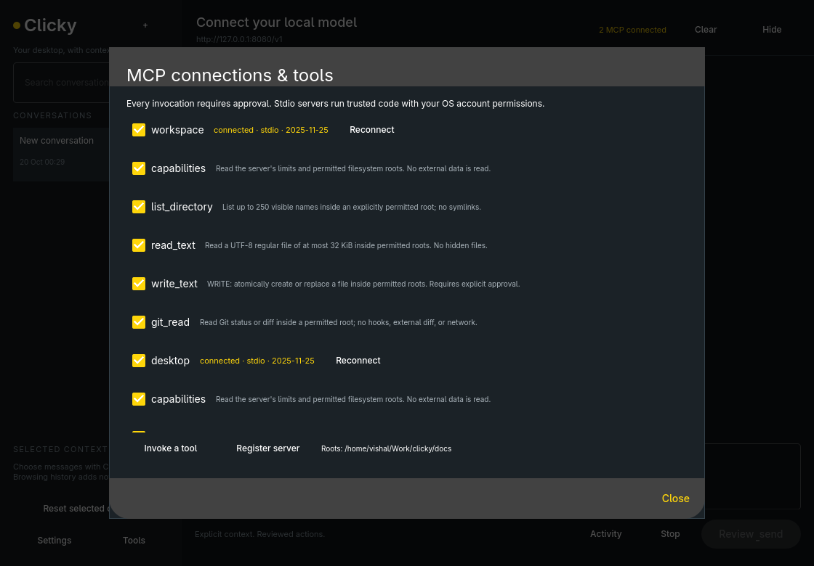

# Clicky for Omarchy

[](https://github.com/vishal88736/clicky-omarchy/actions/workflows/tests.yml)
[](LICENSE)

A native Qt Quick assistant for **Omarchy and Hyprland**. Keep conversations and drafts, choose exactly which past messages become context, preview screen captures, and approve real MCP actions before they run.

**No LLM is bundled.** Connect your own OpenAI-compatible local endpoint for chat. Local model installation was deferred in this implementation, so live model answers, model-driven tool selection and vision understanding remain unverified. The interface, persistence, real MCP transports and desktop integration are implemented and tested; an HTTP test fixture is never presented as a model.

## What works

| Capability | Evidence / boundary |
|---|---|
| Native floating window, launcher, background user service | Tested in the real Hyprland Wayland session; no XWayland UI |
| History sidebar, saved drafts, explicit context, request preview | SQLite and native UI tests; historical browsing does not import context |
| Real MCP stdio, Streamable HTTP and SSE | Actual SDK connections, multiple servers, discovered tools and executed results |
| Reviewed actions | Real writes tested denied/approved/disabled during review; cancellation tested |
| Screen preview and local OCR | Real grim capture and Tesseract recognition tested; region-selection flow still needs manual verification |
| Local voice input | Microphone format tested; installed Voxtype recognized a public speech sample |
| Local model adapter | Streaming, tool loops, cancellation, errors and context tested against a labeled HTTP fixture; live LLM pending |
| Global shortcut | Super+Ctrl+Semicolon registered without conflict; physical-key activation still needs confirmation |
| Speech playback | Implemented with real-engine detection; unavailable here because speech-engine libraries are missing |



Screenshots are rendered from the real app with fresh temporary data and the default accent. No personal desktop capture or history is published.

## Build and launch

On the audited Omarchy installation, all desktop packages were already available. Python dependencies are isolated in `.venv`.

```sh
git clone https://github.com/vishal88736/clicky-omarchy.git
cd clicky-omarchy
bin/build
bin/test
bin/test-ui
bin/clicky open
```

Requirements: Python **3.14**, uv, qmake6, make and Qt **6.12** Core/Gui/Qml/Quick/Controls/Network/TextToSpeech, plus Qt Test for the native harness. Desktop helpers are detected and failures are shown in the UI. See [installation and dependencies](docs/installation.md).

Install the user-local launcher, app icon, shortcut and optional autostart service:

```sh
bin/install
clicky open
clicky check --json
```

Default shortcut: **Super+Ctrl+Semicolon**. Existing bindings are checked, backed up and preserved. The installer adds one marked Lua block, validates Hyprland and refuses file collisions. Use `--no-autostart` or a custom `--hotkey` on a fresh installation. Keep the checkout in place while installed.

## Connect your model

Open **Settings**, enter the endpoint URL (including `/v1`), exact model ID and actual context limit, then save. **Discover models** checks connectivity. Run the separate **text**, **stream**, **tools** and **vision** probes for the capabilities you need. They use synthetic, non-private content and do not execute desktop actions.

Type a question, choose **Review & send**, inspect the exact messages/tool schemas/endpoint, and confirm. Optional credentials use the masked key field and GNOME Keyring. No remote fallback, paid subscription or imported Codex/Claude credentials are required. `config.example.json` contains placeholders only.

## Everyday controls

| Control | Action |
|---|---|
| Ctrl+Enter | Preview a request before sending |
| Ctrl+N / Ctrl+K | New conversation / search history |
| Context beside an older conversation | Explicitly select individual historical messages |
| Screen / Region / Window info | Deliberately attach local context for review |
| OCR | Extract screenshot text locally into the draft |
| Talk / Finish recording | Record locally, transcribe with Voxtype, review the draft |
| Tools / Activity | Inspect connections, schemas, toggles, approvals and results |
| Ctrl+. / Mute | Cancel operations / stop speech |
| Escape / close button | Hide while preserving the session |
| Ctrl+Shift+Q | Quit |

## Permissions and integrations

Every tool call requires a one-use approval, including reads that can disclose data. The two bundled MCP servers provide root-constrained filesystem/Git tools and a dedicated narrow desktop broker. Initial filesystem access is limited to this project's `docs/`. There is no arbitrary shell, recursive delete, continuous capture or clipboard scraping. Pointer movement and restricted single-line typing are separate from general mouse/key automation; typing is disabled by default and terminal/editor hosts are denied.

Add trusted stdio, HTTP or SSE servers without changing application code. Credentials use environment/Keyring references. External stdio servers run with your OS account's permissions; Clicky cannot sandbox arbitrary server code. Browser automation can be connected, but no third-party browser-control server was installed or tested here. See [MCP setup](docs/mcp.md) and [security boundaries](docs/security.md).

Local history/drafts live in `~/.local/share/clicky/history.sqlite3`; configuration is in `~/.config/clicky/config.json`. Both use private filesystem permissions. The app does not encrypt the database. Captures/audio are temporary; detailed tool payloads are not stored in diagnostic logs. Redaction is best effort, so do not put credentials into chat or selected screenshots.

## Tests and current limits

Local Python suite: **21 passed**, including real MCP transports, real approved/denied writes, credential isolation, persistence, context isolation, provider fixtures and native IPC/SIGTERM shutdown. The separate native Qt harness passes both interaction scenarios (QtTest reports 4 entries including init/cleanup). GitHub CI runs the Python suite and skips only the two native-binary lifecycle cases; native UI and live desktop checks are local. Read the [full validation record and acceptance matrix](docs/validation.md).

Remaining checks: connect a real local model, verify physical hotkey activation and interactive region selection, install/verify a real TTS engine if desired, and register/test any external browser MCP server. English is complete for the initial interface; the bundled Hindi catalog is partial and falls back to English.

## Stop and uninstall

```sh
systemctl --user stop clicky.service
systemctl --user disable --now clicky.service
bin/uninstall
```

For a directly launched instance, use `clicky stop`. Uninstall removes only verified app-owned integration files and its marked bindings block. It preserves history, settings, Keyring entries, the checkout and original-config backups. Live reversal restored the original bindings byte for byte, followed by a clean reinstall. See [troubleshooting and data removal](docs/troubleshooting.md).

## Project map

- `src/`: native lifecycle, Qt Quick UI, theme, locale and TTS.
- `clicky/`: provider, context, storage, agent, MCP manager/servers, desktop broker, voice and permissions.
- `tests/`: unit, real transport/action integration, provider-fixture and native UI/lifecycle tests.
- `docs/`: [actual system audit](docs/system-audit.md), [architecture](docs/architecture.md), [source/license review](docs/source-review.md), installation, security, MCP and troubleshooting.

MIT licensed. Independent of HeyClicky and OpenClicky. No code from the unlicensed HeyClicky Linux repository is included. Native theme behavior follows Omarchy's MIT app templates; attribution is preserved in [LICENSE](LICENSE).
