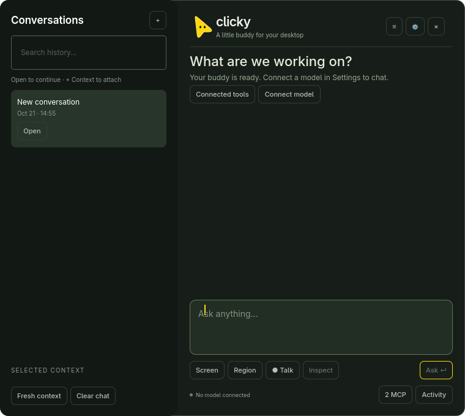

# Clicky for Omarchy

[](https://github.com/vishal88736/clicky-omarchy/actions/workflows/tests.yml)
[](LICENSE)

A native desktop assistant for **Omarchy / Hyprland**. Open a compact prompt to
type, talk, attach a screen capture, or ask a connected tool for help.

**There is no cursor follower.** No background cursor tracking or idle desktop
overlay runs. Optional, temporary visual hints are disabled by default.

Inspired by [Jason Kneen's OpenClicky](https://github.com/jasonkneen/openclicky),
built natively for Wayland with **C++ / Qt Quick and layer-shell-qt**.

## What it does

- **On-demand interface:** a hotkey opens the prompt; Escape dismisses it. Nothing follows the pointer.
- **Compact prompt:** Enter to ask, Shift+Enter for a new line, Ctrl+Enter to inspect
  the exact request. Escape hides the prompt.
- **Conversation drawer:** search history, switch conversations, keep drafts,
  explicitly choose individual historical messages, remove selections and start fresh.
- **Screen context:** capture a monitor or region, preview locally, optionally OCR,
  and review before sending to a verified vision model. Screenshot-relative
  `[POINT:x,y:label]` hints can display a temporary marker when Visual guides is
  explicitly enabled. Markers disappear after a few seconds and never follow the pointer.
- **Real MCP:** negotiate and discover tools over stdio, Streamable HTTP or SSE;
  enable individual tools; inspect arguments and approve each invocation once.
- **Local voice input:** PipeWire recording and installed Voxtype transcription into
  the draft. A real installed Qt speech engine is needed for spoken playback.
- **Omarchy integration:** live accent, launcher entry, global shortcut, optional
  user service, and a floating prompt pinned across workspaces.

**Connect your own model to enable AI answers.** OpenAI-compatible local endpoints
and HTTPS hosted endpoints are supported. No model is downloaded or selected
silently. Live neural chat and vision remain unverified on the development machine
because model setup was deferred; HTTP fixtures are clearly labeled in the tests.

## Build and launch

```sh
git clone https://github.com/vishal88736/clicky-omarchy.git
cd clicky-omarchy
bin/build
bin/clicky open
```

Requires Python 3.14, uv, qmake6, make, Qt 6.12 (Quick, Controls, Network,
TextToSpeech, Wayland), and **layer-shell-qt**. Python dependencies live in `.venv`.
Capture, OCR and microphone helpers are detected separately. See the
[dependency and installation guide](docs/installation.md).

```sh
bin/install                 # launcher, hotkey, optional autostart
clicky open
clicky guides               # opt in/out of temporary visual hints (default off)
clicky hide                 # hide only the prompt
clicky info                 # non-secret UI and guidance flags
```

Default shortcut: **Super + Ctrl + Semicolon**. On a fresh installation, use
`bin/install --hotkey 'SUPER + CTRL + F12'` or `--no-autostart`.
Existing shortcuts are checked for conflicts. Only a marked user configuration
block is added; the installer keeps a backup and an ownership manifest.

## Connect a model

Open **Settings** (gear), set the endpoint including `/v1`, exact model name and
actual context limit, then save. **Discover models** tests connectivity. Run the
separate **text**, **stream**, **tools**, and **vision** probes for the capabilities
needed; they use synthetic data. A listed model is not proof of those capabilities.

Optional API keys use a masked field backed by GNOME Keyring. Configuration stores
endpoint-scoped references. Keys are never committed, passed in process arguments,
or silently forwarded when the endpoint changes. See [config.example.json](config.example.json).

Typed text is submitted with **Ask / Enter**. **Inspect / Ctrl+Enter** shows the
assembled context, endpoint, tools and budget before submission. A screen attachment
always opens the request review first. Screenshots, clipboard contents and window
titles are never automatically attached.

## History and tools

Open **≡** or **Ctrl+K** for the persistent sidebar. **Open** resumes a conversation;
**+ Context** lets you check individual messages for use in the current one.
Browsing a conversation does not import it. Selected context stays visible and each
selection can be removed. **Fresh context** clears historical references;
**Clear chat** asks before deleting that conversation's local messages.



The **MCP** button shows actual connection states, discovered schemas and tool
switches. Two bundled official-SDK servers provide root-constrained filesystem/Git
operations and a separate narrow desktop broker. Manual invocation works without
an LLM. Add trusted servers in the UI or configuration; see [MCP setup](docs/mcp.md).
Every tool invocation requires review, including read operations that could disclose
private data. There is no unrestricted agent shell.


## Verification

```sh
bin/test                    # Python unit + real MCP integration tests
bin/test-ui                 # native Qt interactions and streaming HTTP fixture
.venv/bin/python scripts/verify_desktop.py  # active desktop; read-only checks
```

Current local results: **23 Python tests passed**; **3 native UI scenarios and a guidance-controller case passed**
(QtTest reports 6 entries including setup/cleanup). These cover real MCP sessions,
permissions, context isolation, actual typed HUD input, streaming through a labeled
HTTP fixture, persistence, restart, and cancellation/failure paths.

The native application has been run in the actual Hyprland session. The desktop
check verifies the real app ID, floating/pinned window, clean session configuration,
and absence of any cursor-following surface. It does not inject input. Optional
visual hints support dynamic screen geometry, but physical multi-monitor/hotplug
acceptance remains manual.

Screenshots above are real QML renders with isolated temporary data and the fallback
accent. No personal desktop/history is published.
See [current validation and limitations](docs/validation.md) for exact evidence and
manual checks: real model inference/vision, physical hotkey, interactive region
selection, browser MCP, and audible speech.

## Stop and uninstall

```sh
systemctl --user stop clicky.service       # service-managed instance
bin/clicky stop                            # directly launched instance
bin/uninstall                              # removes owned integration only
```

Uninstall preserves conversations, configuration, Keyring entries, backups and this
checkout. See [clean reversal](docs/troubleshooting.md). The old large chat shell
and its outdated screenshots have been replaced; existing conversation data remains
compatible.

## Design and credits

[System audit](docs/system-audit.md) · [Rebuild audit and plan](docs/buddy-rebuild.md) ·
[Architecture](docs/architecture.md) · [Source review](docs/source-review.md) ·
[Security](docs/security.md) · [Troubleshooting](docs/troubleshooting.md)

Interaction inspiration: OpenClicky by **Jason Kneen** and the original Clicky by
**Farza**. This is an original Linux implementation; macOS source/artwork is not
bundled. [MIT license](LICENSE) · [Third-party notices](THIRD_PARTY_NOTICES.md).
